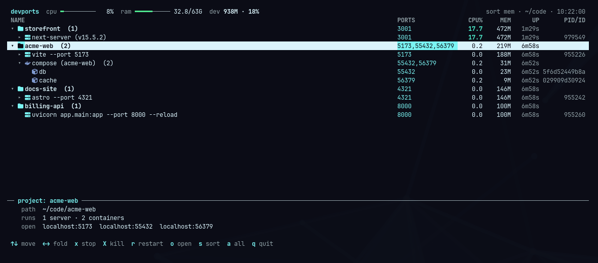
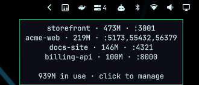
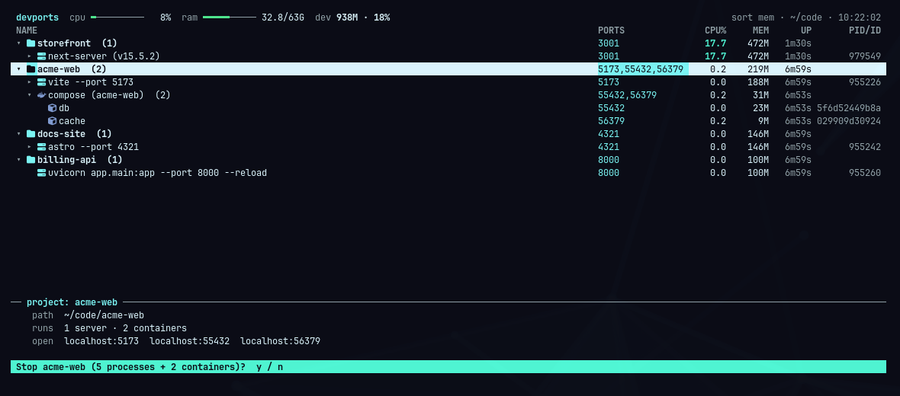

# devports

See every dev server and Docker container you left running, grouped by project, with what each one
costs. Stop any of them, a whole project at a time if you like, without hunting for PIDs.



devports is for people who start a lot of projects and forget to stop them. It finds `pnpm dev`,
`next dev`, Vite, Astro, `ng serve`, uvicorn, Rails and the rest, works out which git checkout each
one belongs to, and puts the Docker Compose or Supabase stack from the same checkout next to it.
Each row shows live CPU, memory, uptime and ports.

It's built for [Omarchy](https://omarchy.org) and comes in three pieces:

- **A bar widget** with a count of projects that have something running. Hover to see them, click to
  open the TUI.
- **A terminal UI** with a tree of projects → servers → processes and containers. Stop, kill, restart
  or open them in the browser.
- **A CLI** for scripts and coding agents: `devports list --json`, `devports kill 3000`.

It's plain Python using only the standard library, and it uses the terminal's palette, so it follows
whichever Omarchy theme you have set.

## What makes it different

- **Grouped by project, not by port.** A Next.js app, its Supabase stack and a worker started from
  the same checkout show up as one project with one total.
- **Stops the whole thing.** `pnpm dev` is a wrapper, a shell and a node process (sometimes more).
  devports stops the whole tree, children first, so nothing is left orphaned holding the port.
- **Safe by construction.** It never climbs past the shell, terminal, editor or agent you launched
  from, never signals itself, and only signals a pid whose start time still matches what it saw, so a
  recycled pid is never hit.
- **Honest memory.** Processes use PSS, so shared pages aren't counted twice. Containers use the same
  figure `docker stats` shows.
- **Scriptable.** Everything the TUI shows is available as JSON.

## Install

### As an Omarchy plugin (recommended)

```sh
omarchy plugin add https://github.com/jakedx6/devports --enable
```

This clones devports to `~/.config/omarchy/plugins/jakedx6.devports` and adds the widget to the right
side of your bar. Click it to open the TUI.

To also get the `devports` command, a **Dev Servers** entry in the app launcher (Super+Space) and,
if you agree when asked, an entry under **Trigger → Dev Servers** in the Omarchy menu, run:

```sh
~/.config/omarchy/plugins/jakedx6.devports/install.sh
```

### From a clone

```sh
git clone https://github.com/jakedx6/devports ~/.local/share/devports
~/.local/share/devports/install.sh
```

You get the CLI, the launcher entry and (optionally) the menu entry, but no bar widget.

### Requirements

- Omarchy (it's built and tested on Omarchy 4 / Quattro). Python 3.11+, `ss` and `jq` are already
  part of it.
- Docker is optional. Without it you just don't see containers.

## Use

### Bar widget



| Action | Result |
| --- | --- |
| Hover | Projects with something running, their memory and ports |
| Click | Open the TUI (floating), or focus it if it's already open |
| Right-click | Refresh now |

You can also bind it to a key: `omarchy shell jakedx6.devports open`.

### TUI

Run `devports`, click the widget, or pick **Dev Servers** from the launcher.

| Key | Action |
| --- | --- |
| `↑` `↓` / `j` `k`, `PgUp` `PgDn`, `g` `G` | Move |
| `→` `←` / `l` `h`, `Enter`, click | Expand / collapse; `←` on a child jumps to its parent |
| `x` | Stop the selected row: SIGTERM to its process tree, `docker stop` for containers |
| `X` | Force: SIGKILL / `docker kill` |
| `r` | `docker restart` the selected containers |
| `o` | Open `http://localhost:<port>` in the browser |
| `s` | Sort by memory, CPU, name or uptime |
| `a` | Toggle every listening process (Steam, Ollama, …) vs project servers only |
| `R` | Refresh now |
| `q` | Quit |

Stopping a project stops everything under it. Every stop asks for confirmation first.



### CLI

```sh
devports list            # table: projects and their servers/stacks
devports list -d 2       # include individual processes and containers
devports list --json     # the whole tree, for scripts and agents
devports kill 3000       # stop whatever serves :3000 (process tree or container)
devports kill 3000 -f    # SIGKILL / docker kill
```

If you use a coding agent, tell it that `devports list --json` shows what's running and
`devports kill <port>` stops it cleanly. That saves it from guessing with `lsof` and `pkill`.

## Configure

**Project folders.** devports shows servers running inside your project folders. By default it
watches whichever of these exist: `~/Projects`, `~/projects`, `~/Code`, `~/code`, `~/src`, `~/dev`,
`~/Developer`, `~/repos`, `~/work`, `~/git`, `~/workspace`. If none exist, it watches your whole home
folder. To choose your own:

```sh
export DEVPORTS_ROOTS=~/code:~/clients      # colon separated
devports --root ~/code --root ~/clients     # or per run
```

A variable exported in your shell profile only reaches `devports` run from a terminal. To use the
same folders from the app launcher and the Omarchy menu, also add
`export DEVPORTS_ROOTS=~/code:~/clients` to `~/.config/uwsm/env` and log in again. The bar widget
has its own **Project folders** setting.

Press `a` (or pass `-a`) to see every listening process and every container, wherever they are.

**Widget settings.** In the Omarchy bar settings, or in `~/.config/omarchy/shell.json`:

| Setting | Default | |
| --- | --- | --- |
| `projectFolders` | empty | Folders to watch, colon separated. Empty uses the defaults above |
| `refreshIntervalSec` | `10` | How often the count updates |
| `hideWhenIdle` | `false` | Hide the icon when nothing is running |
| `windowMode` | `Floating` | `Tiled` opens the TUI as a normal tiled window |

**Window size.** The floating window is 1280×760. Set `DEVPORTS_WINDOW_SIZE="1440 900"` in your
environment to change it.

## How it measures

- **Servers** are found with `ss -tlnp`, which needs no root and shows only your own processes. Each
  listening process is grouped with the wrappers that launched it (`pnpm`, `npm exec`, `sh -c`) and
  all their children, up to the shell, terminal, editor or agent you started it from. Climbing also
  stops at any parent working outside the project, so an unrecognised terminal or IDE is never
  treated as part of a server.
- **Projects** are the enclosing git checkout of the server's working directory.
- **Containers** come from `docker ps`. Stacks attach to a project through the
  `com.docker.compose.project.working_dir` or `com.supabase.cli.workdir` label, and like servers
  they're shown when that folder is inside your project folders. Containers with no folder (a plain
  `docker run`) are always shown.
- **Memory** is PSS for processes (shared pages split between users, so totals don't double count)
  and cgroup memory minus inactive page cache for containers. GPU memory isn't included.
- **CPU** is measured between refreshes; 100% is one full core.

## Troubleshooting

**Nothing shows up.** Your servers are probably outside the folders devports watches. The TUI
header and the empty screen show which folders those are. Set `DEVPORTS_ROOTS` or press `a`.

**"docker: permission denied".** Add yourself to the docker group with
`sudo usermod -aG docker $USER`, then log out and back in.

**The widget doesn't appear after installing.** Run `omarchy-shell shell rescanPlugins`, then
`omarchy plugin enable jakedx6.devports right`.

**Something isn't grouped or named the way you'd expect.** Please open an issue with the output of
`devports list --json -a`, after removing anything private.

## Remove

```sh
~/.config/omarchy/plugins/jakedx6.devports/install.sh --uninstall   # only if you ran install.sh
omarchy plugin disable jakedx6.devports
omarchy plugin remove jakedx6.devports
```

For a clone, run its `install.sh --uninstall` and delete the folder. `--uninstall` removes the
command links, the launcher entry and the menu entry (it saves a backup of the menu file first).

## Contributing

Bug reports and pull requests are welcome. See [CONTRIBUTING.md](CONTRIBUTING.md).

## License

[MIT](LICENSE)
